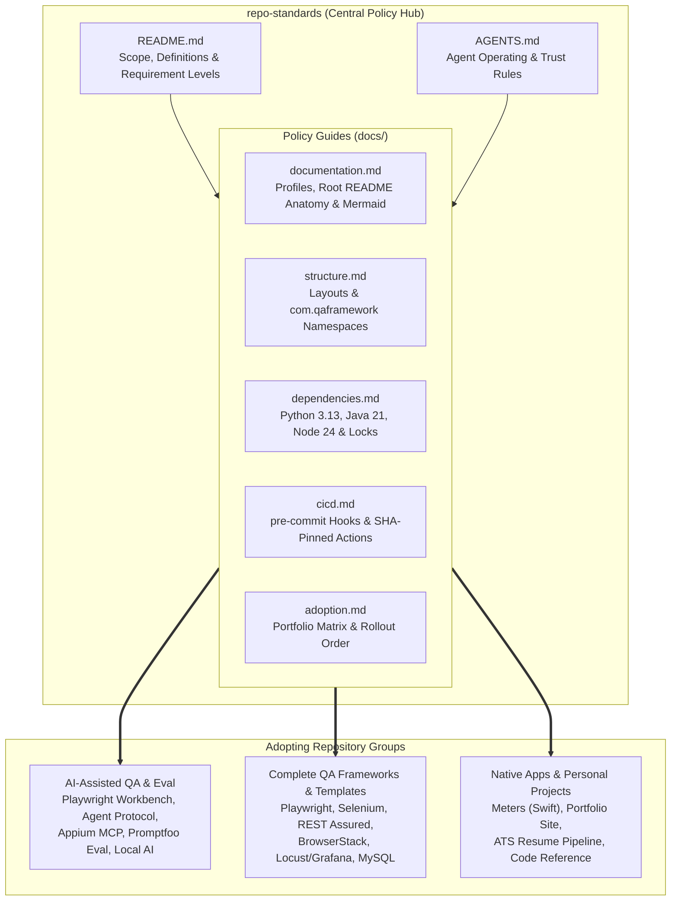
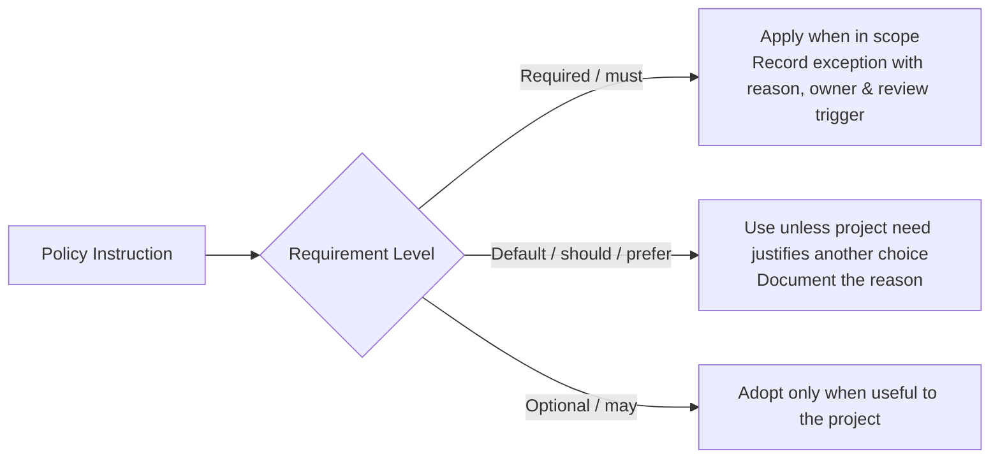
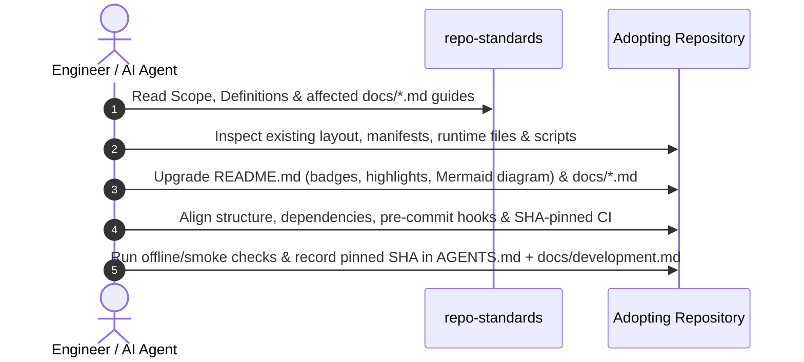

# repo-standards


[](LICENSE)

Shared repository standards for documentation, folder structure, dependencies
and quality gates across Yashwant Das’s repositories and repositories of other
owners who opt in separately. Both human engineers and AI coding agents read
these guides before modifying any adopting repository.

## What this repository governs

- **Showcase-ready documentation:** Every adopting repository presents a clear
  value proposition, [Shields.io](https://shields.io/) stack/status badges, an
  inline [Mermaid](https://mermaid.js.org/) architecture or workflow diagram, a
  project structure and tech stack overview, and runnable verification commands
  directly in its root `README.md`.
- **Predictable Markdown baseline:** Eliminates missing or scattered documentation
  by assigning every repository a profile (`complete`, `small` or `personal`)
  with a defined set of lowercase kebab-case guides under `docs/`.
- **Deliberate runtime and lockfile baselines:** Standardizes **Python 3.13**
  (`uv`, `Ruff`), **Java 21** (`Maven`, `com.qaframework.<project>`),
  **Node.js 24** (`npm ci`, `Playwright`, `WebdriverIO`, `Promptfoo`) and
  **Swift** without silently breaking existing compatibility sets.
- **Defense-in-depth quality gates:** Combines fast staged `pre-commit` hooks
  with SHA-pinned GitHub Actions workflows, least-privilege token permissions
  and explicit separation between offline checks and live browser, device,
  database or LLM runs.

## Architecture

`repo-standards` acts as the central policy specification. Adopting repositories
record their profile and pinned `repo-standards` commit SHA in `AGENTS.md`,
document verification and exception evidence in `docs/development.md`, and keep
their root `README.md` focused on showcasing the project itself:



### Repository layout

```text
repo-standards/
├── README.md               # Scope, shared definitions, requirement levels and policy index
├── AGENTS.md               # Operating instructions and trust boundaries for AI agents
├── LICENSE                 # MIT License
└── docs/
    ├── documentation.md    # Profiles, README anatomy, Mermaid rules, metadata and markdownlint
    ├── structure.md        # Python, Java, JS/TS, multi-runtime and Swift folder conventions
    ├── dependencies.md     # Runtime baselines, compatibility sets, lockfiles and Ruff
    ├── cicd.md             # PR check baselines, pre-commit gates and workflow security
    └── adoption.md         # Repository portfolio matrix and staged per-repository workflow
```

## Scope

This repository is a set of readable instructions for engineers and AI agents.
It needs no validator, package tooling, test suite, automated hooks or CI of its
own. Review its content, diagrams and links when editing. Automated gates in
these guides apply to adopting software repositories; documentation-only
repositories need content and link review. A `personal` documentation profile
does not exempt executable code from applicable software checks.

This standards repository uses a topic index and focused policy guides instead
of application setup and architecture documents. Its five guides cover separate
policies and the adoption roadmap.

The supported language stacks are **Python**, **Java**, **JavaScript/TypeScript**
and **Swift**.

## Definitions

Pending owner sign-off to adopt this as the shared table; the guides already use
these terms, so treat them as the operative meanings and record any conflict as
pending work until approval.

| Term | Meaning |
| --- | --- |
| Maintained | Intended for current use, with an owner responsible for keeping it accurate or working; excludes archived records and generated output. |
| Complete project | A maintained application or substantial test framework (including full-featured starter templates). It uses the `complete` documentation profile. |
| Substantial test framework | Reusable test infrastructure with at least two of: several execution modes or environments, external integrations (browsers, devices, cloud services, databases or LLMs), shared layers such as page objects, fixtures or drivers, and CI or reporting configuration. |
| Maintained framework | Any reusable application or test infrastructure that is in current use and has a named owner, whatever its size. A substantial test framework is a maintained framework, but not the reverse. |
| Software repository | A repository containing executable application, library, test or build/generation code, including personal-content projects with such code. |

## Requirement levels



- **Required / must:** apply when in scope. Record any exception with its reason,
  owner and review trigger.
- **Default / should / prefer / normally:** use unless an existing approach or
  project need justifies another choice; document the reason.
- **Optional / may:** adopt only when useful to the project.

These describe the target standard. Existing repositories adopt it in stages;
record pending work without claiming full compliance. Soft modal phrasing such
as “normally” or “usually” reads as a default, not a requirement. Conditional
qualifiers such as “where practical” or “where available” are in-scope
conditions, not defaults — the rule applies when the condition holds. Unless
explicitly marked default or optional, policy instructions and rule lists in
these guides are required within scope; examples and rollout suggestions are not
requirements.

## Using the standards



Read the relevant guides before changing a repository. Inspect its existing
structure and commands, apply the relevant profile, and preserve justified
exceptions. Record the chosen profile and a link to these standards in that
repository's `AGENTS.md` (and detailed adoption evidence in
`docs/development.md`), keeping the root `README.md` clean for external readers.
Use a repository URL that works outside the local workspace. Adopters must pin
the standards to a tag or commit SHA and record it locally. Use a commit SHA
when no suitable tag exists.

## Standards

| Guide | Scope | Key Requirements |
| --- | --- | --- |
| [Documentation](docs/documentation.md) | Profiles, root `README.md` anatomy, diagrams, metadata & linting | Badges, `Why it exists` / highlights, mandatory root Mermaid diagram, `docs/architecture.md` & `docs/development.md`, `markdownlint-cli2` |
| [Folder structure](docs/structure.md) | Directory conventions, multi-runtime layouts & Java namespaces | Standard `src/`, `tests/`, `docs/` layouts, `com.qaframework.<project>` Java packages, functional folder preservation |
| [Dependencies](docs/dependencies.md) | Deliberate runtime baselines, compatibility sets & lockfiles | Python 3.13 (`uv.lock`, `Ruff`), Java 21 (`Maven`), Node.js 24 (`package-lock.json`), weekly Dependabot PRs |
| [CI/CD](docs/cicd.md) | Pre-commit gates, PR check matrices & workflow security | Staged `pre-commit` hooks, offline vs. live check separation, full-SHA GitHub Actions pinning |
| [Adoption roadmap](docs/adoption.md) | Portfolio classification, pilot targets & rollout workflow | One-repository-at-a-time end-to-end adoption and verification ledger |

## License

MIT. See [LICENSE](LICENSE).
