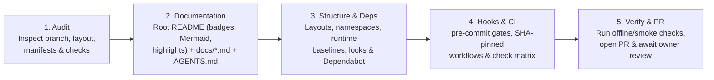

# Adoption roadmap

Documentation and presentation are the entry point, followed by structure,
dependencies, hooks and CI. Adopt these standards **one repository at a time**
from audit through pull request and owner review before starting the next
repository. Keep private repository details within their existing access
boundaries.

## Portfolio profile mapping

Every public repository maps to a specific documentation profile and showcase
focus. Private repositories (such as local Apple Silicon AI utilities, hosted
LLM script sandboxes, multi-language reference notes, ATS resume pipelines and
in-progress client/multi-platform frameworks) follow the same profile rules
within their access boundaries.

| Group | Repository | Profile | Documentation & Showcase Focus |
| --- | --- | --- | --- |
| **AI-Assisted QA** | `ai-py-playwright-workbench` | `complete` | Badges, demo GIF, `What it demonstrates`, root Mermaid heal/generate diagram, `docs/architecture.md`, `docs/development.md`, `docs/decisions.md`, `docs/generation.md` |
| **AI-Assisted QA** | `ai-ts-playwright-protocol` | `complete` | Badges, `Why it exists`, root Mermaid task-lifecycle diagram, `docs/architecture.md` (or `docs/protocol.md`), `docs/development.md` (consolidating `docs/CLI.md`) |
| **AI-Assisted QA** | `ai-js-appium-mcp` | `complete` | Badges, `Who does what`, root Mermaid sequence diagram, consolidate `docs/framework.md` & `docs/appium-mcp.md` with `docs/architecture.md` & `docs/development.md` |
| **AI-Assisted QA** | `ai-js-promptfoo-eval` | `complete` | Badges, `Why it exists`, root Mermaid two-layer grading diagram, benchmark results tables, `docs/architecture.md`, `docs/development.md` (with customizing guide) |
| **Complete QA Framework** | `qa-java-playwright` | `complete` | Restore badges, `What it demonstrates`, root Mermaid execution diagram, structure & stack tables to `README.md`; retain `docs/architecture.md`, `docs/development.md`, `docs/examples.md` |
| **Complete QA Framework** | `qa-java-restassured-payments` | `complete` | Badges, Allure report screenshot, `What this project demonstrates`, root Mermaid signed-HTTP + MySQL diagram, split `docs/framework-guide.md` into `docs/architecture.md` & `docs/development.md` |
| **Complete QA Framework** | `qa-py-selenium-requests` | `complete` | Add tool badges, `What it demonstrates`, root Mermaid web + API architecture diagram to `README.md`; extract deep setup/config into `docs/architecture.md` & `docs/development.md`; add `AGENTS.md` |
| **Complete QA Framework** | `qa-py-browserstack` | `complete` | Add CI/stack badges, `Why it exists`, root Mermaid local vs. BrowserStack SDK routing diagram to `README.md`; add `docs/architecture.md`, `docs/development.md` & `AGENTS.md` |
| **Complete QA Framework** | `qa-py-locust-grafana` | `complete` | Badges, Grafana spike screenshot, `Why it exists`, root Mermaid OTLP/Prometheus/Grafana diagram; add `docs/architecture.md`, `docs/development.md` & `AGENTS.md` |
| **Complete QA Framework** | `qa-js-mysql` | `complete` | Add stack badges, `What it demonstrates`, root Mermaid Jest/Python -> Docker MySQL diagram; replace `docs/ENVIRONMENT.md` with `docs/architecture.md` & `docs/development.md`; add `AGENTS.md` |
| **Starter Template** | `qa-py-selenium` | `complete` | Replace long monolithic README with concise showcase `README.md` (badges, template steps, root Mermaid POM/driver flow diagram, Allure preview) + `docs/architecture.md`, `docs/development.md` & `AGENTS.md` |
| **Starter Template** | `qa-java-selenium` | `complete` | Add badges and root Mermaid POM/ThreadLocal diagram to `README.md`; consolidate `FRAMEWORK_ARCHITECTURE.md` & `TESTING_GUIDELINES.md` into `docs/architecture.md` & `docs/development.md`; retain `ARCHITECTURE-GUIDE.md` as historical record |
| **Native App** | `meters` | `complete` | Add stack/release badges and a root Mermaid sampling-to-popover data-flow diagram to `README.md`; add `docs/architecture.md`, `docs/development.md` & `AGENTS.md` |
| **Profile & Portfolio** | `yashwant-das.github.io` | `personal` | Add stack badges and a Mermaid content-schema -> Vite build -> Playwright check -> Pages diagram to `README.md`; consolidate `DESIGN.md` & `PRODUCT.md` under `docs/` |
| **Profile & Portfolio** | `yashwant-das` | `personal` | Retain concise three-paragraph profile bio `README.md` (exempt from badges, diagrams and `docs/`) |

These are target profiles, not claims that every repository has completed
migration. Promote `small` script collections or demos to `complete` only when
their architecture or setup requires dedicated guides.

## Per-repository execution workflow

Within each repository, apply changes on a dedicated branch from the fetched
default branch while preserving existing branches and unrelated work:

1. **Upgrade documentation and presentation first:**
   - Ensure the root `README.md` includes [Shields.io](https://shields.io/)
     badges, a clear value proposition (`Why it exists` / `What it demonstrates`),
     an inline [Mermaid](https://mermaid.js.org/) architecture or workflow
     diagram, a project structure and tech stack summary, runnable quickstart
     and verification commands, and links to `docs/`.
   - Create or refine `docs/architecture.md`, `docs/development.md` and
     `AGENTS.md` according to the repository's profile, consolidating scattered
     root Markdown files.
2. **Align folder conventions, runtime declarations and dependencies:**
   - Apply directory and namespace conventions (such as `com.qaframework.<project>`
     for Java QA frameworks) together with imports, suite files, logging and
     documentation links.
   - Lock compatible stable library versions and enable weekly Dependabot PRs
     for the package ecosystems the repository uses, as required by the
     [dependency standard](dependencies.md).
3. **Configure pre-commit and CI quality gates:**
   - Add staged `pre-commit` hooks (including `markdownlint-cli2` with
     `.markdownlint-cli2.jsonc`) and harden GitHub Actions workflows with full
     commit-SHA pinning, least-privilege permissions and weekly `github-actions`
     updates, following the [CI/CD standard](cicd.md).
4. **Verify locally and record evidence:**
   - Run offline unit, lint, format, type-check and controlled smoke suites.
   - Record the pinned `repo-standards` commit SHA and profile in `AGENTS.md`,
     and record detailed verification evidence, skipped host/cloud checks and
     any pending exceptions in `docs/development.md`. Keep the root `README.md`
     free of rollout-tracking boilerplate.
   - Open the pull request and wait for owner review before starting the next
     repository.

## Completion and later work

An exception requires a documented reason, owner and review trigger. Check
`README.md` commands, Mermaid rendering and moved links before opening a pull
request; report any checks that could not be run locally. Documentation adoption
alone does not imply that dependency practices or CI gates have been adopted.

Later work may include shared workflows and coordinated dependency updates across
repositories where reuse reduces maintenance. Per-repository weekly dependency
PRs belong to the repository's own adoption turn; central automation is optional
future work.
