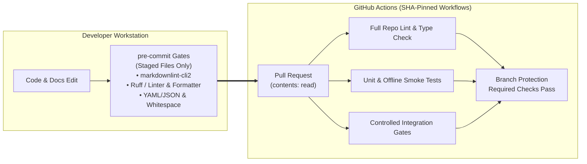

# CI/CD

Required checks and workflow safety for repositories that follow these
standards.

## PR check baselines

Apply the [scope](../README.md#scope) and [definitions](../README.md#definitions).
Combine supported-language and project-specific checks; documentation profiles
do not replace them.

| Language / files | Required PR checks |
| --- | --- |
| Python | Ruff lint and format, tests; type check for maintained frameworks |
| Java | compile, tests, static analysis |
| JavaScript / TypeScript | lint, format check, tests; type check for TypeScript |
| Swift | native build and applicable tests/checks, documented per repository |
| Maintained Markdown | markdownlint-cli2 with the [documentation baseline](documentation.md) |

| Project purpose | Additional checks / evidence |
| --- | --- |
| Browser / API / database | Controlled integration or smoke tests for supported flows |
| Performance / monitoring | Load configuration and threshold checks; document full-run scope |
| Device / cloud / LLM | Document integration prerequisites, execution evidence and skipped scope |
| Personal content with executable code | Applicable build or generation checks plus content/link review |

Include Markdown linting on documentation-only PRs in software repositories.
Tests must exercise behavior; document unavailable or inapplicable checks.

Document check scope in `docs/development.md` or a `small` project's `README.md`.
Agent-driven projects may use collection as an exception; it proves discovery, not
execution.

## Pre-commit gates

Software repositories must check staged files before commit. Default to
[pre-commit](https://pre-commit.com/) and `.pre-commit-config.yaml`; preserve an
equivalent existing hook manager. Do not install competing managers.

| Files | Required checks |
| --- | --- |
| Maintained Markdown | markdownlint-cli2 with the documentation baseline |
| Python | Ruff lint and format checks |
| JavaScript / TypeScript | Established linter and formatter in check mode |
| Java | Established formatter/style check when practical on staged files |
| Applicable text/config files | Trailing whitespace, final newline, merge-conflict markers, YAML/JSON syntax |

Use file filters and narrow exclusions for generated files and dependencies.
Preserve intentional Markdown hard breaks; configure syntax checks for actual
file formats (for example, JSONC is not strict JSON). Document exceptions.

Pin hook revisions and align tool versions with CI and project locks. Document
`pre-commit install` after cloning and `pre-commit run --all-files` for full checks,
or equivalents. For uv projects, lock pre-commit in the development group and
prefix both commands with `uv run`.

Keep hooks fast and independent of services after setup. Leave full tests, builds,
type checks and browser/device/cloud runs in CI or optional pre-push checks. Review
and restage hook fixes; never automatically stage unrelated changes.

Failed hooks block commits. Agents must not bypass hooks without explicit user
authorization; record authorized bypasses and unresolved checks. CI must independently
check all maintained files in scope, including unchanged files, with the same rules,
versions and exclusions. Hooks check staged files only.

## Quality gates

The following gates are required within scope.

- Identify required check names and configure branch protection or rulesets where
  available. Workflow presence alone does not make a check required for merging.
- Required checks must pass for the revision being merged. Do not mask failures
  with `continue-on-error`, unconditional success, or empty test runs.
- Keep offline checks runnable without secrets. Run browser/API smoke tests against
  controlled targets where practical; starter templates must demonstrate a working
  example from a clean checkout.
- Separate device, paid cloud and LLM integration checks. Document how to run them,
  their prerequisites and when they are required. A skipped run is not a pass;
  changes to those integrations need relevant execution evidence or a recorded
  exception with owner, reason and review trigger.
- Preserve existing coverage thresholds. Choose new thresholds from meaningful
  project risks and measured coverage; there is no universal percentage quota.
- Run the same documented commands locally and in CI. Changes to documentation
  need Markdown linting where required above and a content/link review, not a new
  test suite.

## Workflow safety

The following workflow rules are required.

- Pin every third-party action to a full commit SHA.
- Use `pull_request`, not `pull_request_target`, for PR-triggered workflows.
- Set `permissions` to the minimum required (usually `contents: read`).
- Add `timeout-minutes` to every job.
- Cache dependency installs when the project has a lock file.
- Set `persist-credentials: false` on checkout steps.
- Keep artifact retention short (1–3 days for CI; longer only for releases).

## Security and supply chain

The following levels apply to adopting software repositories with relevant workflows:

- **Required:** retain SHA pinning and enable weekly action updates with Dependabot
  (`package-ecosystem: github-actions`, `directory: /`) or an equivalent updater.
  See [GitHub's configuration](https://docs.github.com/en/code-security/how-tos/secure-your-supply-chain/secure-your-dependencies/auto-update-actions).
- **Default:** repositories should enable secret scanning and code scanning where
  available for their plan, visibility and stack. Check
  [feature availability](https://docs.github.com/en/code-security/getting-started/github-security-features)
  before choosing an implementation.
- **Optional:** published artifacts may include provenance attestations and an
  SBOM, with consumer verification instructions. See
  [artifact attestations](https://docs.github.com/en/actions/concepts/security/artifact-attestations).
- **Future, not required:** plan to adopt workflow dependency locking after general
  availability and a compatibility review. GitHub's
  [announcement](https://github.blog/changelog/2026-10-14-github-actions-workflow-lockfiles-in-public-preview/)
  identifies it as public preview. GitHub's documentation says in-workflow SHA
  pinning is unnecessary once a repository adopts a lockfile, so adoption requires
  amending the SHA-pinning rules in this guide first.

## Deployments

Deploy the checked revision after required checks pass, from a trusted branch
or release event. Keep deployment credentials out of untrusted PR jobs. Define
environments in GitHub when the project has staging or production targets.

## GitHub inheritance

GitHub provides defaults only for supported community health files from a public
`.github` repository in the same account. These standards, `AGENTS.md` and
workflows do not automatically propagate. Each adopting repository must reference
the standards explicitly. They apply to Yashwant Das’s repositories and
repositories of other owners who opt in separately.
See [GitHub's supported defaults](https://docs.github.com/en/communities/setting-up-your-project-for-healthy-contributions/creating-a-default-community-health-file).
