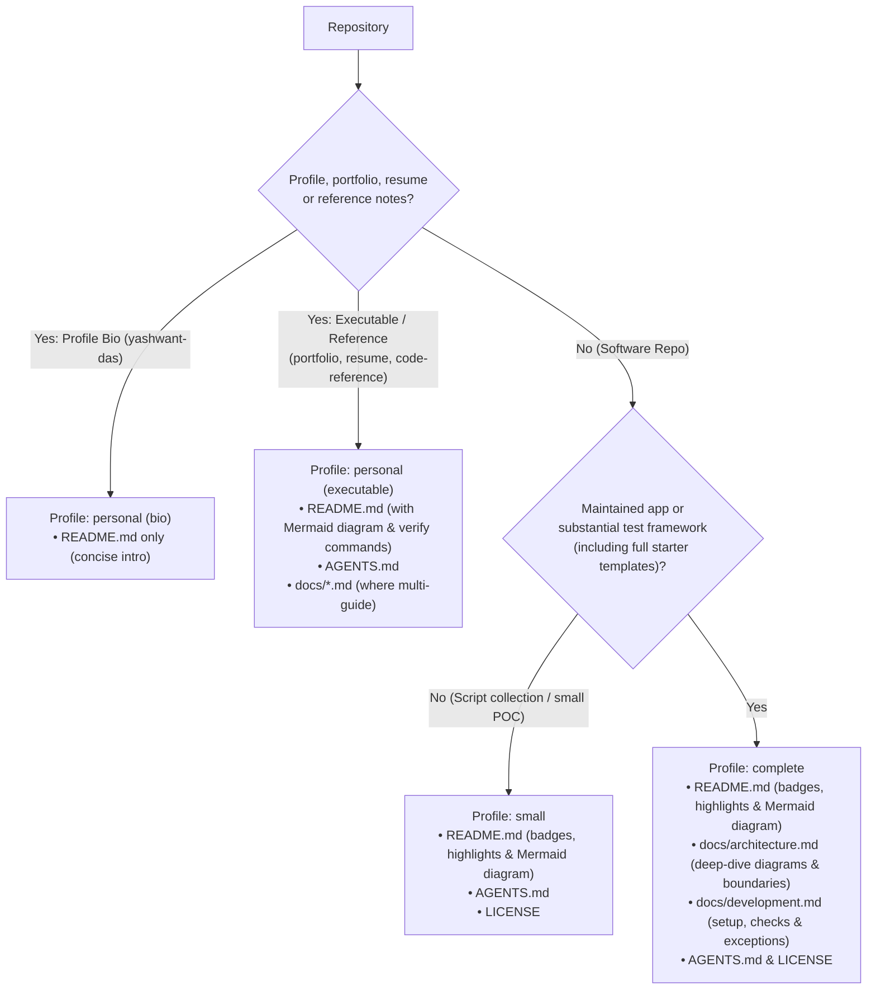
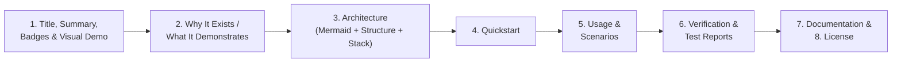

# Documentation standard

Every repository is an engineering showcase read by **hiring managers,
recruiters, peer QA/software engineers and AI coding agents**. Documentation
must make the repository's purpose, engineering depth, architecture and
verification evidence obvious on the landing page while keeping setup and daily
maintenance straightforward.

Choose a profile based on what the repository does, and record the chosen
profile and pinned `repo-standards` revision in `AGENTS.md` (with detailed
adoption evidence in `docs/development.md`). Keep the root `README.md` focused
on the project itself rather than internal rollout metadata. Use the shared
[definitions](../README.md#definitions). Instructions below are required unless
explicitly marked default or optional.

## Writing style and repository metadata

Write in plain, direct, technical prose:

- **Show, do not hype:** Describe concrete mechanisms, invariants and evidence
  (for example, *"repairs failing locators via a TypeScript AST edit and halts
  when failure confidence points to an application bug"*). Avoid marketing
  adjectives (`modern`, `robust`, `comprehensive`, `lightweight`,
  `reference-grade`, `production-grade`), emojis in prose or resume buzzwords.
- **GitHub repository description:** One sentence, **maximum 110 characters**,
  no trailing period (so it fits three lines on a pinned profile card). Start
  with an active verb (*"Tests…"*, *"Generates…"*, *"Grades…"*, *"Runs…"*), name
  2–4 core tools, and append `(starter template)` or `(proof of concept)` when
  applicable. Personal repositories use a plain noun phrase.
- **GitHub topics:** Maximum 8 topics per software repository, ordered as:
  1. Category (1): `ai-testing`, `test-automation` or `llm`
  2. Language (1): `python`, `java`, `typescript` or `javascript`
  3. Tools (2–5): canonical slugs such as `playwright`, `selenium`, `appium`,
     `pytest`, `testng`, `rest-assured`, `webdriverio`, `browserstack`,
     `locust`, `grafana`, `opentelemetry`, `prometheus`, `mysql`, `jest`,
     `promptfoo`, `ollama`, `mcp`
  4. Technique (0–2): such as `api-testing`, `web-testing`, `mobile-testing`,
     `load-testing`, `database-testing`, `self-healing-tests`,
     `test-generation`, `llm-evaluation`

  Do not use version numbers (`java-21`), redundant synonyms (`playwright-java`),
  generic filler (`qa`, `testing`, `automation`) or universal patterns
  (`page-object-model`). Personal repositories use 0–4 plain topics (`meters`
  retains 6 native macOS/LLM topics for search reach; the profile repository uses
  none).

## Documentation profiles and minimum Markdown baseline

Every repository must contain a root `README.md` and `LICENSE` (where licensed).
No software repository may lack structured Markdown documentation or have
unindexed, inconsistently named Markdown files scattered in the root directory.



| Profile | Required Markdown files | Use for |
| --- | --- | --- |
| `complete` | `README.md`, `AGENTS.md`, `docs/architecture.md`, `docs/development.md`, `LICENSE` | Maintained applications (`ai-py-playwright-workbench`, `meters`), AI testing workflows (`ai-ts-playwright-protocol`, `ai-js-appium-mcp`, `ai-js-promptfoo-eval`), and substantial test frameworks including full starter templates (`qa-java-playwright`, `qa-java-restassured-payments`, `qa-py-selenium-requests`, `qa-py-browserstack`, `qa-py-locust-grafana`, `qa-js-mysql`, `qa-py-selenium`, `qa-java-selenium`) |
| `small` | `README.md`, `AGENTS.md`, `LICENSE` | Focused script collections and single-directory demos without multi-layer framework infrastructure (such as `ai-py-llm-sandbox`) |
| `personal` | `README.md` (plus `AGENTS.md` and `docs/*.md` when the project includes build, validation or test code) | GitHub profile README (`yashwant-das`), portfolio site (`yashwant-das.github.io`), ATS-verified resume builder (`resume`) and multi-language reference notes (`code-reference`) |

A `complete` project has the two core guides (`docs/architecture.md` and
`docs/development.md`) and at most two additional maintained guides under
`docs/` (such as `docs/protocol.md`, `docs/appium-mcp.md`, `docs/generation.md`,
`docs/examples.md` or `docs/customizing.md`). Add more only when the `README.md`
documentation index explains why each is needed. Do not create empty guides to
satisfy a count.

Consolidate legacy uppercase root or `docs/` Markdown files (such as
`FRAMEWORK_ARCHITECTURE.md`, `TESTING_GUIDELINES.md`, `DESIGN.md`, `PRODUCT.md`,
`docs/PROTOCOL.md`, `docs/CLI.md` or `docs/ENVIRONMENT.md`) into lowercase
kebab-case guides under `docs/`. Where an AI coding assistant requires a root
`CLAUDE.md`, keep it as a one-line import or pointer to `AGENTS.md` rather than
duplicating instructions.

The document budget excludes community files (`CONTRIBUTING.md`, `SECURITY.md`),
`CHANGELOG.md`, `ROADMAP.md`, task/prompt catalogs (`tasks/*.md`,
`prompts/*.md`, `specs/*.md`) and historical design records (such as
`ARCHITECTURE-GUIDE.md` or `docs/superpowers/`). Label historical plan
directories clearly as historical records so they are not mistaken for current
setup instructions.

## Root README anatomy and presentation bar

A reviewer landing on a repository should understand **what it does, what
engineering problems it solves, how its components fit together and how to run
and verify it** without leaving the main page.

For `small` and `complete` profiles, structure the root `README.md` in this
order (adapting section titles naturally when a project-specific heading such as
`## What this project demonstrates` or `## Why it exists` is clearer):



1. **Title, opening summary, badges and visual preview:**
   - Start with one H1: either `# <repo-name>` or a meaningful title that reflects
     the project. Follow it with a concise paragraph explaining what the project
     does and its scope boundaries, and a row of [Shields.io](https://shields.io/)
     badges: CI workflow status, live report badge (such as Allure on GitHub
     Pages when published), License, primary language/runtime and 1–3 core tools.
   - When the project has a web UI, native UI, Grafana dashboard or published
     test report, include a GIF or screenshot right below the badges or in the
     architecture/results section (`docs/assets/`).
2. **`## Why it exists` or `## What this project demonstrates`:**
   - Explain the concrete engineering problem the repository solves and 3–6
     capabilities it proves (for example, request signing and per-step database
     assertions, client vs. server latency gap visibility, or wrapping browser
     agents in a deterministic verification gate).
   - For **starter template repositories** (`qa-py-selenium`, `qa-java-selenium`),
     include a short `## Start a project from this template` numbered checklist
     showing which config files, page objects and tests to replace after copying.
3. **`## Architecture` (Mandatory root Mermaid diagram, structure and stack):**
   - **Required root diagram:** Every `small` and `complete` software repository
     (and every `personal` repository with an executable build or test pipeline)
     **must** include at least one inline [Mermaid](https://mermaid.js.org/)
     diagram (`flowchart` or `sequenceDiagram`) directly in its root `README.md`
     showing how components, test runners, agents, services or data flows
     interact. Do not relegate the primary diagram solely to
     `docs/architecture.md`.
   - Pair the diagram with a concise **Project structure** tree/table and a
     **Tech stack** table (layer, tool, version and purpose) so visitors can
     scan the repository layout and toolchain on the main page. In `complete`
     projects, link to `docs/architecture.md` for deep-dive internals.
4. **`## Quickstart`:**
   - State prerequisites (runtime baseline, Docker, simulator/emulator, local
     model or credentials), installation steps and one runnable command with its
     expected output (such as `BUILD SUCCESS` or passing spec count).
5. **`## Usage`:**
   - Common tasks, scenarios, environment switching or CLI flags. Link to
     `docs/development.md` for exhaustive configuration and troubleshooting.
6. **`## Verification` (or `## Test reports and results`):**
   - Commands that confirm the project works and what each command actually
     tests. Clearly distinguish offline checks (lint, format, type check, unit
     tests and controlled smoke runs) from live external integrations (public
     demo sites, BrowserStack, local LLMs or mobile emulators). Summarize what
     CI runs automatically and where reports (Allure, Promptfoo, Locust,
     Playwright HTML) are written or published.
7. **`## Documentation`:**
   - Links and one-line descriptions for `docs/architecture.md`,
     `docs/development.md` and any optional guides or historical records. Omit
     when `README.md` is the only guide.
8. **`## License`:**
   - Place last when present. For public MIT repositories, write
     `MIT. See [LICENSE](LICENSE).` Do not invent an MIT license for unlicensed
     private or personal content.

Keep the root `README.md` scannable in under five minutes by moving exhaustive
troubleshooting, long Java/Python code templates, environment variable tables and
hook/adoption audits into `docs/development.md` and `docs/architecture.md`.

## Maintained guides

| Guide | Required contents |
| --- | --- |
| `docs/architecture.md` | Component responsibilities, execution/data-flow Mermaid diagrams, thread/session/fixture lifecycle, external boundaries and key design trade-offs |
| `docs/development.md` | Detailed setup, environment/override matrix, adding tests or features, local pre-commit and CI quality gates, troubleshooting and documented dependency/check exceptions |

Optional guides should cover a distinct substantial topic, such as an agent
protocol (`docs/protocol.md`), MCP setup (`docs/appium-mcp.md`), model-dependent
generation examples (`docs/generation.md`) or evaluation customization
(`docs/customizing.md`). Keep each detailed explanation in one authoritative
place and link to it. Preserve useful existing material when splitting or
renaming guides; update incoming links in the same change.

## Formatting and diagrams

These rules are required across all maintained Markdown files:

- Use GitHub-Flavored Markdown, one `#` H1 per file and sequential heading
  levels (`#` → `##` → `###`).
- Use lowercase kebab-case filenames for guides under `docs/`; retain
  conventional uppercase root names (`README.md`, `AGENTS.md`, `CLAUDE.md`,
  `LICENSE`, `CONTRIBUTING.md`, `SECURITY.md`, `CHANGELOG.md`, `ROADMAP.md`).
- Use relative links inside the repository and descriptive link labels.
- Label every fenced code block with its language (`bash`, `powershell`,
  `python`, `java`, `javascript`, `typescript`, `json`, `jsonc`, `yaml`, `sql`,
  `mermaid`, `text`). Commands must state their working directory when it
  differs from the root; distinguish placeholders from literals.
- Use tables for structured comparisons, test coverage matrices and tech stacks;
  use lists for sequential steps. Avoid duplicate command catalogs across files.
- Use [Mermaid](https://mermaid.js.org/) (`flowchart` or `sequenceDiagram`) for
  architecture, component and workflow diagrams so diagrams stay diffable and
  render natively on GitHub.
- Store screenshots, GIFs and exported diagram assets in `docs/assets/` (or
  existing `docs/` image folders until migrated) with descriptive alt text.
- Update affected docs and diagrams alongside behavior changes and check links
  after file moves.

## Markdown linting

Adopting software repositories must lint maintained Markdown with
[markdownlint-cli2](https://github.com/DavidAnson/markdownlint-cli2), using the
same configuration locally and in CI. See the [scope](../README.md#scope) for
applicability.

Use the default rules with `MD013` (line length) disabled so tables, links,
badges and commands do not need artificial wrapping. Keep heading, spacing,
fenced-code language and image-alt-text checks enabled. Record narrowly scoped
exceptions with a reason; avoid blanket rule disables to accommodate one file.

Store the baseline in the adopting repository's `.markdownlint-cli2.jsonc`:

```jsonc
{
  "config": {
    "default": true,
    "MD013": false
  }
}
```

Lint the root `README.md`, agent/community Markdown files and maintained guides.
Explicitly exclude dependencies (`node_modules`, `.venv`), generated output and
archived plans from the selected paths. Historical exclusions must not hide
current documentation.

In Node repositories, lock `markdownlint-cli2` as a development dependency and
expose an `npm run lint:md` script. Python, Java and Swift repositories may use
a pinned CLI or a SHA-pinned lint action; document an equivalent local command
without forcing application code into a Node project. Never install an unbounded
`latest` version in CI. Run in check mode there; apply fixes locally and review
the diff.

Linting checks Markdown conventions, not command correctness or link
reachability. Continue reviewing content, diagrams and links when documents
change.
